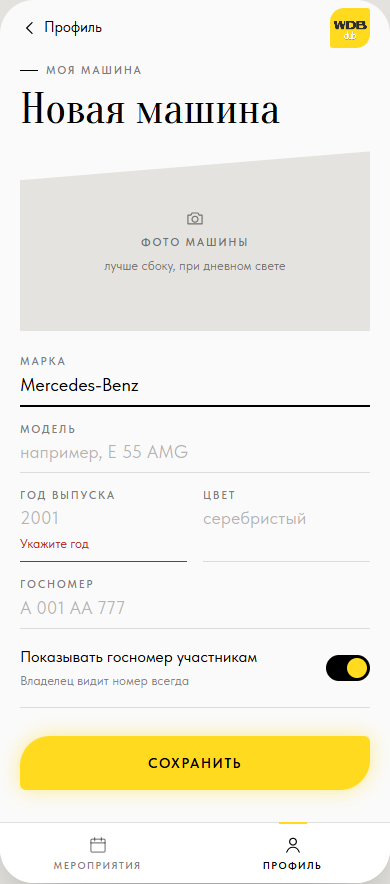
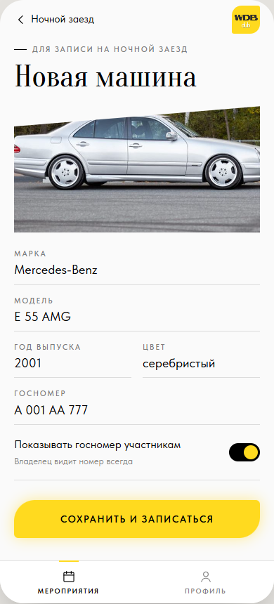

# ТЗ: Форма машины

Статус: ТЗ согласовано владельцем 09.11.2026, реализовано (PR, #2). Приоритет: P1.
Трекинг: issue #2.

Экран: добавление и изменение машины. Три входа: «Добавить» в профиле
(S15), «Добавить машину» из шторки записи (S16), «Изменить» на карточке
машины. Файл: `app/views.js` (`viewCarForm`), правила — `app/logic.js`
(`validateCar`).

Макет (согласован 09.11.2026): S15, S16; сценарии 1 и 6 в `mockups/flows.html`.

| S15 · из профиля (с ошибкой) | S16 · из записи |
|---|---|
|  |  |

## Бизнес-требование

Участник за минуту добавляет машину: стандартные поля и фото. Сам решает,
видят ли его госномер другие участники. Если пришёл из записи — после
сохранения сразу записан.

**Definition of Done** (из #2):

- [x] Стандартные поля (марка, модель, год, цвет, госномер) и фото; заполняется, сохраняется, редактируется.
- [x] Показ госномера решает владелец машины (ответ владельца 09.11.2026).
- [x] Из записи — после сохранения обратно к мероприятию с записью.

## ТЗ

**Состав:** шапка «‹ Профиль» / «‹ <мероприятие>»; рубрика «Моя машина» или
«Для записи на <мероприятие>»; заголовок «Новая машина» / «<модель>» при
изменении; фото `.upload`; поля `.field`: Марка, Модель, Год выпуска + Цвет
(`.field-row`), Госномер; переключатель «Показывать госномер участникам»
(по умолчанию выключен); кнопка «Сохранить» / «Сохранить и записаться».

**Фото:** тап по зоне фото — выбор файла (`<input type="file"
accept="image/*">`, в телефоне — камера или галерея). Картинка ужимается в
браузере до 900 px по ширине (JPEG 0.8) и сохраняется вместе с машиной;
после выбора видна в зоне фото, повторный тап — заменить. Фото
необязательно. Не картинка или не прочиталась — ошибка под зоной «Не
удалось открыть фото, выберите другое».

**Проверка (при «Сохранить»):**

| Поле | Правило | Ошибка |
|---|---|---|
| Марка | обязательно, до 40 символов | «Укажите марку» |
| Модель | обязательно, до 40 символов | «Укажите модель» |
| Год выпуска | обязательно, 4 цифры, от 1886 до следующего года | «Укажите год» / «Год от 1886 до <следующий>» |
| Цвет | необязательно, до 30 символов | — |
| Госномер | необязательно, до 15 символов, сохраняется заглавными | — |

Ошибка — `.field.is-error` + `.field__err` под полем, фокус на первое
поле с ошибкой; ошибка поля пропадает при его изменении. Значение «Марка»
по умолчанию — «Mercedes-Benz» (клуб марки), можно изменить.

**После сохранения:** из профиля — назад в профиль, тост «Машина
сохранена»; при изменении — назад на карточку машины; из записи — машина
сохраняется, запись на мероприятие (правила [`../registration.md`](../registration.md)),
переход на карточку мероприятия в состоянии S6 (или S8, если мест не
осталось).

**Критерии приёмки:**

- [x] Пустые марка, модель или год не сохраняются; ошибки — как на S15.
- [x] Год вне диапазона — ошибка с диапазоном.
- [x] Фото выбирается, ужимается, видно в форме и на карточке; переживает перезагрузку.
- [x] Переключатель госномера сохраняется и влияет на список участников.
- [x] «Сохранить и записаться» сохраняет машину и записывает на мероприятие.
- [x] Изменение машины меняет её в профиле, на карточке и в моих записях.
- [x] Вид совпадает с S15, S16.

## Известные расхождения

Нет.
