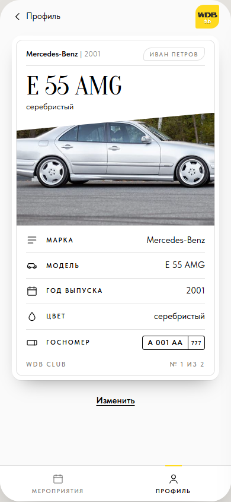

# ТЗ: Машина

Статус: ТЗ согласовано владельцем 09.11.2026, реализовано (PR, #2). Приоритет: P1.
Трекинг: issue #2.

Экран: коллекционная карточка моей машины, открывается из профиля.
Файл: `app/views.js` (`viewCar`).

Макет (согласован 09.11.2026): S14; сценарий 5 в `mockups/flows.html`.

## Бизнес-требование

Машина — главное в профиле участника клуба. Карточка показывает её так, как
её видят другие участники мероприятия, и даёт её изменить.

**Definition of Done** (из #2):

- [x] Профиль машины: стандартные поля и фото, виден, редактируется.

## ТЗ

**Состав:** шапка «‹ Профиль»; `.car-card`: «<марка> | <год>», бейдж —
моё имя; модель `.t-display`; цвет; фото со скосом (без фото — заглушка
`--sand`); характеристики `.spec`: Марка, Модель, Год выпуска, Цвет,
Госномер (`.plate`; номер не указан — «—»); подвал «WDB Club» и «№ k из n»
(порядковый номер машины в профиле); под карточкой ссылка «Изменить» →
[`car-form.md`](car-form.md) с заполненными полями.

**Госномер:** разбивается на номер и регион по последнему пробелу или по
последним 2–3 цифрам («А 001 АА 777» → «А 001 АА» + «777»); не разобрался —
весь текст в `.plate__n`, без региона.

**Удаление (#8):** рядом с «Изменить» — `.link.link--quiet` «Удалить» →
шторка `.sheet` «Удалить <модель>?» с `.btn` «Удалить» и «Отмена». После
удаления — профиль, тост «Машина удалена». Машина в записи на будущее
мероприятие — тост «Машина записана на „<название>“ — сначала отмените
запись», карточка остаётся.

**Критерии приёмки:**

- [x] Все пять характеристик и фото из сохранённой машины.
- [x] «№ k из n» соответствует порядку в «Моих машинах».
- [x] «Изменить» открывает форму с текущими значениями; после сохранения карточка обновлена.
- [x] Вид совпадает с S14.
- [x] «Удалить» с подтверждением; машину из записи на будущее мероприятие не удалить (#8, e2e).

## Известные расхождения

Нет.
