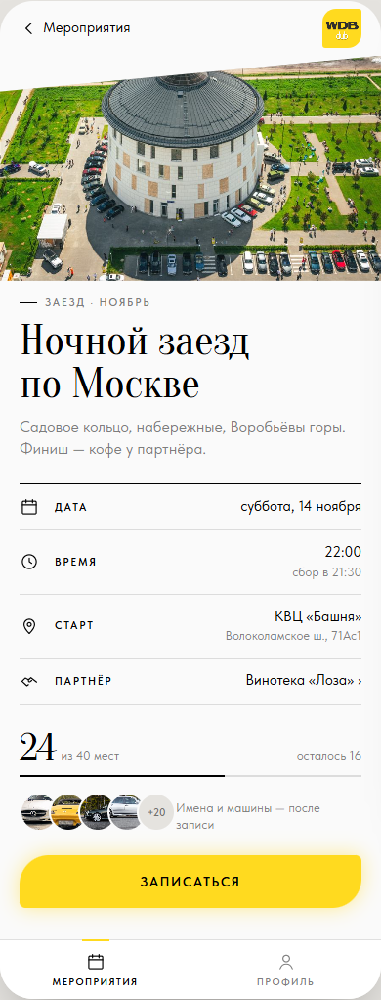
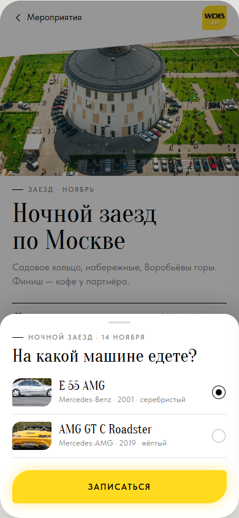
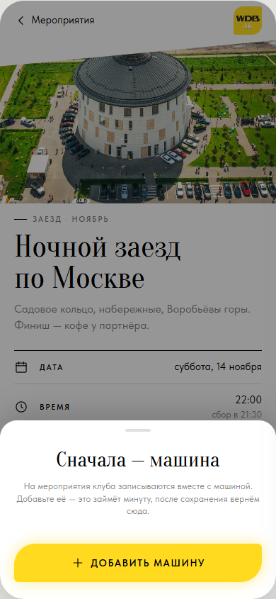
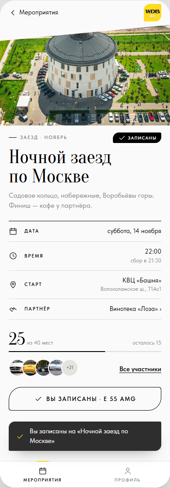
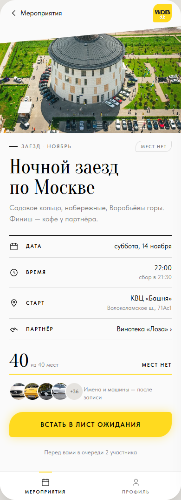
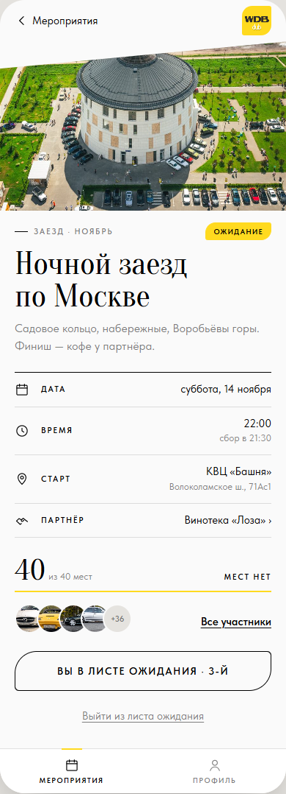

# ТЗ: Карточка мероприятия и запись

Статус: ТЗ согласовано владельцем 09.11.2026, в работе. Приоритет: P1.
Трекинг: issue #2.

Экран: карточка мероприятия, открывается из списка (S1) и из «Моих
записей» (S12). Файл: `app/views.js` (`viewEvent`, шторки `sheetPickCar`,
`sheetNeedCar`).

Правила записи, очереди и видимости — [`../registration.md`](../registration.md).

Макет (согласован 09.11.2026): S3–S8; сценарии 1–4 в `mockups/flows.html`.

| S3 · места есть | S4 · выбор машины | S5 · нет машины |
|---|---|---|
|  |  |  |

| S6 · записан | S7 · мест нет | S8 · в очереди |
|---|---|---|
|  |  |  |

## Бизнес-требование

Участник видит всё о мероприятии и записывается в одно-два касания на своей
машине. Видно, сколько мест занято, и записан ли он. Если мест нет — встаёт
в лист ожидания.

**Definition of Done** (из #2):

- [ ] Без машины записаться нельзя: «Записаться» ведёт на создание машины, после сохранения — обратно с записью.
- [ ] Лимит мест — параметр мероприятия; «N из M мест»; можно записаться и отменить.
- [ ] Мест нет — лист ожидания.
- [ ] Партнёр в карточке, тап открывает страницу партнёра.

## ТЗ

**Состав:** шапка с «‹ Мероприятия» (или «‹ Профиль», если пришли из
профиля); обложка `.cover`; рубрика «<тип> · <месяц>» и тег статуса справа;
название `.t-display`; описание `.t-lede`; факты `.facts`: Дата, Время (+
«сбор в …», если задан), Старт (+ адрес), Партнёр (строка-кнопка «›»);
места `.seats` + `.meter` (`.meter--full`, когда мест нет); миниатюры
`.thumbs` (до 4 фото + «+N»); справа от миниатюр — ссылка «Все участники»
(записан или в очереди) или подпись «Имена и машины — после записи»;
кнопка и действия.

**Кнопка по состоянию:**

| Состояние | Кнопка | Под кнопкой |
|---|---|---|
| Не записан, места есть (S3) | `.btn` «Записаться» | — |
| Не записан, мест нет (S7) | `.btn` «Встать в лист ожидания» | «Перед вами в очереди N участников» |
| Записан (S6) | `.btn--done` «✓ Вы записаны · <модель>» | «Добавить в календарь», «Отменить запись» (`.link--quiet`) |
| В очереди (S8) | `.btn--done` «Вы в листе ожидания · N-й» | «Выйти из листа ожидания» |
| Мероприятие прошло | кнопки нет, подпись «Мероприятие прошло» | — |

**Сценарий «Записаться»:** нет машин → шторка S5 «Сначала — машина»,
«Добавить машину» → форма «из записи» (S16, см. [`car-form.md`](car-form.md));
одна машина → запись сразу; несколько → шторка S4 с выбором (по умолчанию
последняя использованная) и «Записаться». После записи — тост S6,
тактильный отклик в Telegram, кнопка и тег меняются, «N из M» растёт.
«Встать в лист ожидания» — тот же выбор машины.

**«Добавить в календарь»:** скачивает `.ics` с датой, временем, местом и
названием — в Telegram открывается системным календарём. Это ссылка из
согласованного макета S6.

**Шторка:** закрывается тапом по затемнению и свайпом вниз не обязательно —
достаточно тапа по затемнению.

**Партнёр:** тап по строке «Партнёр» → [`partner.md`](partner.md).
Участники: «Все участники» или тап по миниатюрам → [`participants.md`](participants.md).

**Критерии приёмки:**

- [ ] Все шесть состояний S3–S8 совпадают с макетом.
- [ ] Без машины «Записаться» открывает S5, после «Сохранить и записаться» — снова карточка в состоянии S6 на новой машине.
- [ ] С несколькими машинами — выбор в S4; в кнопке S6 — выбранная модель.
- [ ] «N из M» и шкала пересчитываются при записи и отмене.
- [ ] При `занято = cap` — «Встать в лист ожидания», после — S8 с местом в очереди.
- [ ] «Отменить запись» / «Выйти из листа ожидания» возвращают S3 / S7 и показывают тост.
- [ ] Запись переживает перезагрузку страницы (`localStorage`).
- [ ] Внутри Telegram «назад» — системной кнопкой.

## Известные расхождения

Нет.
