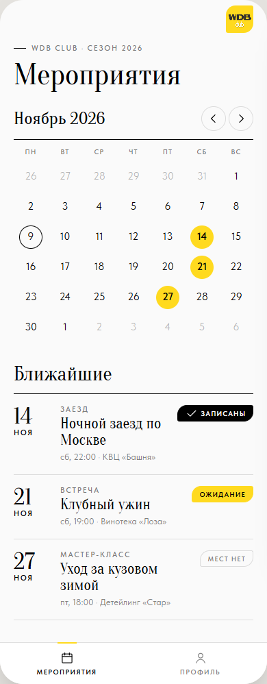
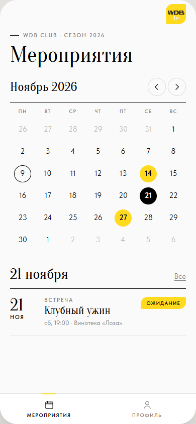

# ТЗ: Мероприятия

Статус: ТЗ согласовано владельцем 09.11.2026, реализовано (PR, #2). Приоритет: P1.
Трекинг: issue #2.

Экран: стартовая вкладка «Мероприятия». Файл: `app/views.js` (`viewEvents`).

Связанные доки: [`../registration.md`](../registration.md), дизайн-система — [`../design-system.md`](../design-system.md).

Макет (согласован 09.11.2026): `mockups/stage-1.html` S1, S2; сценарии 1–2 в `mockups/flows.html`.

| S1 · месяц и ближайшие | S2 · выбран день |
|---|---|
|  |  |

## Изменение #14 (запрос владельца 10.11.2026)

Календарь (S1/S2) убран. Экран — заголовок «Мероприятия» и ближайшие
мероприятия **карточками**: обложка `.cover` (нажатие → карточка
мероприятия), строка `.ev-row` (дата, тип, название, время и место) и кнопка
по состоянию: «Записаться» / «Встать в лист ожидания» (`.btn`, запись прямо
из списка, затем — карточка мероприятия), «Вы записаны · <машина>» /
«Вы в листе ожидания · N-й» (`.btn--done`, открывает карточку). Метки статуса
в строке нет — статус на кнопке. Прошедшие не показываются. Пусто — «Скоро
анонс». Новых компонентов ДС нет. Скриншоты — PR #14.

Участник открывает мини-апп и сразу видит, какие мероприятия впереди, на
какие он записан и где стоит в очереди. Отсюда начинается запись.

**Definition of Done** (из #2):

- [x] В навигации только «Мероприятия» и «Профиль».
- [x] Календарь месяца и список ближайших мероприятий со статусом участника.
- [x] Тап по мероприятию открывает его карточку.

## ТЗ

**Состав (сверху вниз):** шапка (`.appbar`, плитка логотипа, без «назад»);
рубрика «WDB CLUB · сезон <год>»; заголовок «Мероприятия» (`.t-display`);
календарь (`.month`, `.cal`); заголовок раздела (`.section-head`) и список
(`.ev-row`); таб-бар (`.tabbar`, активна «Мероприятия»).

**Календарь:** открывается на текущем месяце; стрелки листают месяцы.
Недели с понедельника, дни соседних месяцев — `.is-out`. День с
мероприятием — `.has-ev`, сегодня — `.is-today`, выбранный — `.is-sel`.
Тап по дню с мероприятиями выбирает его (S2): раздел называется «<д>
<месяца>», справа ссылка «Все» снимает выбор. Тап по выбранному дню тоже
снимает выбор. Тап по дню без мероприятий ничего не делает.

**Список:** без выбора — «Ближайшие»: мероприятия от сегодня и позже по
дате, все. Строка: дата антиквой + месяц, рубрика-тип, название, подпись
«<дн>, <время> · <место>», справа тег: `.tag--on` «Записаны», `.tag--wait`
«Ожидание», `.tag--full` «Мест нет» (если не записан и мест нет), иначе тега
нет. Ближайших нет — пустое состояние (`.empty`) «Скоро анонс» / «Новые
мероприятия появятся здесь».

**Состояния:** данные локальные — загрузки и ошибки нет; пустое — выше.

**Критерии приёмки:**

- [x] Таб-бар из двух вкладок; вкладка «Мероприятия» активна.
- [x] Сегодня обведено, дни с мероприятиями жёлтые; стрелки меняют месяц.
- [x] Тап по дню с мероприятием фильтрует список, «Все» и повторный тап снимают фильтр.
- [x] Статус в строке совпадает с записью (записан / ожидание / мест нет).
- [x] Прошедшие мероприятия не попадают в «Ближайшие».
- [x] Вёрстка — только классы ДС; вид совпадает с S1, S2.

## Известные расхождения

Нет.
