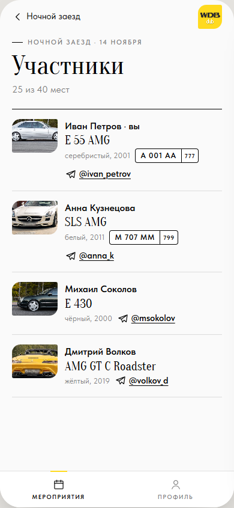
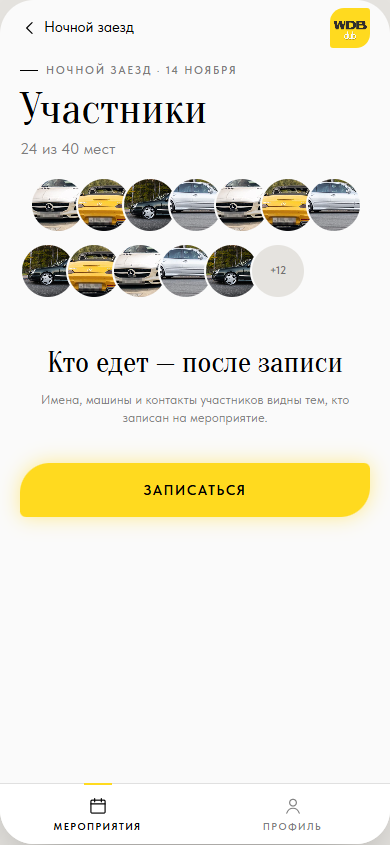

# ТЗ: Участники мероприятия

Статус: ТЗ согласовано владельцем 09.11.2026, реализовано (PR, #2). Приоритет: P1.
Трекинг: issue #2.

Экран: список участников, открывается из карточки мероприятия.
Файл: `app/views.js` (`viewParticipants`).

Видимость — [`../registration.md`](../registration.md), раздел «Видимость».

Макет (согласован 09.11.2026): S9, S10; сценарий 3 в `mockups/flows.html`.

| S9 · вы записаны | S10 · вы не записаны |
|---|---|
|  |  |

## Бизнес-требование

Записанный видит, кто едет: имя, машину с фото, Telegram для связи. Не
записанный видит только миниатюры — это мотивирует записаться.

**Definition of Done** (из #2):

- [x] Записанный видит полный список (имя, машина с фото, Telegram), не записанный — только миниатюры.
- [x] Госномер — только если владелец машины разрешил.

## ТЗ

**Шапка:** «‹ <короткое название мероприятия>». Рубрика «<название> · <дата>»,
заголовок «Участники», подпись «N из M мест».

**Записан или в очереди (S9):** список `.person`: фото машины, имя
(первым — «<я> · вы»), модель антиквой, «<цвет>, <год>», номерной знак
`.plate` (если разрешён), ссылка Telegram `@ник` (открывает чат в Telegram:
`openTelegramLink`, вне Telegram — `https://t.me/<ник>`). Порядок — по
времени записи, я первым.

**Не записан (S10):** сетка миниатюр 56 px (фото машин, без имён) + «+N»;
пустое состояние «Кто едет — после записи» с пояснением; кнопка
«Записаться» — тот же сценарий, что в карточке.

**Пусто:** никто не записан — `.empty` «Пока никого» / «Станьте первым».

**Список видит только организатор (#23):** у мероприятия с
`peopleOrganizerOnly` экран открывается только организатору (как S9, со
всеми записанными и очередью). Остальным входа нет: на карточке нет
миниатюр и «Все участники»; если экран всё же запрошен (история навигации,
состояние после перезагрузки), вместо него открывается карточка мероприятия.

**Критерии приёмки:**

- [x] Записанный и стоящий в очереди видят S9, остальные — S10.
- [x] Номерной знак показан только у участников, разрешивших его; мой — по моему переключателю.
- [x] Ссылка Telegram ведёт в чат участника.
- [x] «Записаться» на S10 работает как в карточке (с машиной / без).
- [x] Вид совпадает с S9, S10.

## Известные расхождения

Нет.
