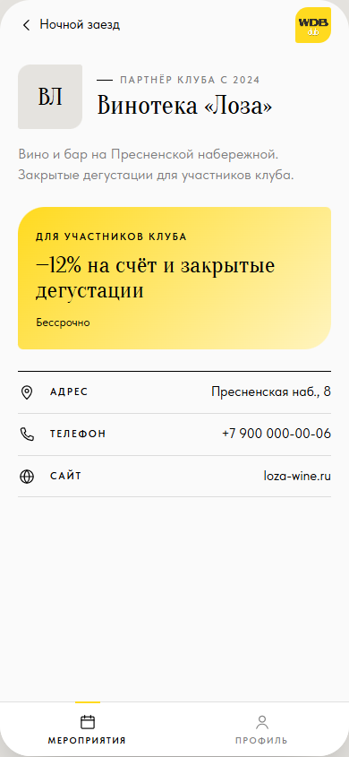

# ТЗ: Партнёр мероприятия

Статус: согласуется. Приоритет: P2.
Трекинг: issue #2.

Экран: страница партнёра, открывается из строки «Партнёр» в карточке
мероприятия. Раздела «Партнёры» в навигации больше нет.
Файл: `app/views.js` (`viewPartner`).

Макет (согласован 09.11.2026): S11.

## Бизнес-требование

Участник узнаёт, у кого проходит мероприятие и что партнёр даёт членам
клуба.

**Definition of Done** (из #2):

- [ ] Партнёр в карточке мероприятия, тап открывает страницу партнёра.
- [ ] Страница — как в прототипе (предложение, адрес, телефон, сайт), без карты участника (ответ владельца 09.11.2026).

## ТЗ

**Состав:** шапка «‹ <мероприятие>»; знак партнёра `.partner-mark` (две
буквы) + рубрика «Партнёр клуба с <год>» + название `.t-title`; описание
`.t-lede`; предложение `.offer` («Для участников клуба», текст, срок);
факты: Адрес, Телефон, Сайт.

**Действия:** Адрес → Яндекс Карты по адресу (`https://yandex.ru/maps/?text=…`),
Сайт → сайт партнёра; Телефон — номер выделяемым текстом, тап — `tel:`
(в Telegram может не сработать, номер виден и копируется).

**Критерии приёмки:**

- [ ] Открывается из карточки любого мероприятия с партнёром; без партнёра строки «Партнёр» нет.
- [ ] Нет кнопки «Показать карту участника» и QR.
- [ ] Адрес и сайт открываются во внешнем браузере / картах.
- [ ] Вид совпадает с S11.

## Известные расхождения

Нет.
