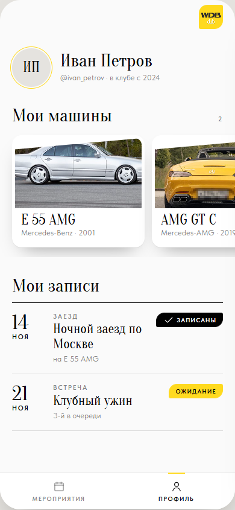
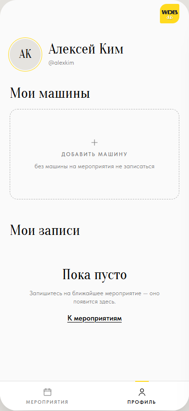

# ТЗ: Профиль

Статус: согласуется. Приоритет: P1.
Трекинг: issue #2.

Экран: вкладка «Профиль». Файл: `app/views.js` (`viewProfile`).

Связанные доки: [`../registration.md`](../registration.md).

Макет (согласован 09.11.2026): S12, S13; сценарии 5–6 в `mockups/flows.html`.

| S12 · машины и записи | S13 · новичок |
|---|---|
|  |  |

## Бизнес-требование

Участник видит свои машины и свои записи со статусом — это и есть его
«прогресс» по мероприятиям. Отсюда добавляют и открывают машины.

**Definition of Done** (из #2):

- [ ] Профиль машины виден в профиле.
- [ ] Карты участника с QR и настроек уведомлений нет.

## ТЗ

**Состав:** шапка (без «назад»); `.profile-head`: аватар (фото из Telegram,
иначе инициалы), имя, `@ник` (из Telegram; вне Telegram — заглушка);
раздел «Мои машины» со счётчиком; лента `.car-strip`: превью `.car-tile`
(фото, модель, «<марка> · <год>») и плитка «Добавить» (`.car-tile--add`);
раздел «Мои записи»: строки `.ev-row` моих записей, ближайшие сначала,
подпись — «на <модель>» или «N-й в очереди», тег статуса.

**Новичок (S13):** машин нет — одна широкая плитка «Добавить машину» с
подписью «без машины на мероприятия не записаться»; записей нет — `.empty`
«Пока пусто» и ссылка «К мероприятиям» (переключает вкладку).

**Переходы:** превью машины → [`car.md`](car.md); «Добавить» →
[`car-form.md`](car-form.md) (из профиля, S15); строка записи → карточка
мероприятия (шапка «‹ Профиль»).

**Критерии приёмки:**

- [ ] Машины и записи берутся из `localStorage` и переживают перезагрузку.
- [ ] Прошедшие записи в «Моих записях» не показываются.
- [ ] Состояние новичка — как S13, с машинами и записями — как S12.
- [ ] Вкладка «Профиль» активна; переходы работают.

## Известные расхождения

Строка «в клубе с 2024» на S12 — вымышленная (стажа нет ни в Telegram, ни в
данных прототипа). В коде её нет, пока клуб не даст источник.
